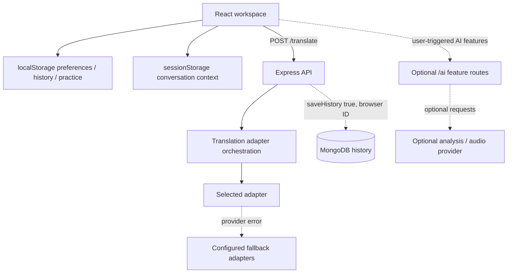

# AWAZ architecture

## Current stack

- React 19 and Vite 8 frontend, using React Router hash navigation for static hosting.
- Express 4 backend with REST routes, WebSocket meeting signaling, Helmet, CORS and rate limits.
- Mongoose 9 for opt-in cloud translation history.
- Browser Web Speech APIs for speech recognition and speech synthesis.
- Tesseract.js for in-browser OCR.

## Request paths

## Frontend modules

| Module | Responsibility |
| --- | --- |
| `src/components/Layout.jsx`, `Sidebar.jsx` | Responsive navigation, route title, network/backend status. |
| `src/pages/HomeView.jsx` | Text translation, browser speech recognition, playback and context choice. |
| `src/components/TranslationVerificationPanel.jsx`, `CodeSwitchPanel.jsx` | Optional translation review and mixed-language analysis in the existing Translate page. |
| `src/pages/MeetingsView.jsx` | Voice/video rooms, conference signaling, turn based speech translation and translated voice playback. |
| `ConversationView.jsx` | Speaker A/B turn based translation. |
| `VisionView.jsx` | Image upload/camera capture, local OCR, editable text and translation. |
| `PracticeView.jsx` | Transcript comparison practice and local live voice frequency meter. |
| `HistoryInsightsViews.jsx` | Browser-local history and saved-data metrics. |
| `ControlViews.jsx` | Provider, appearance, accessibility and service settings. |
| `lib/api.js` | Backend HTTP client. No provider secret is sent by the frontend. |
| `lib/storage.js` | Local preferences/history and optional session context. |

## Backend modules

| Module | Responsibility |
| --- | --- |
| `server/server.js` | HTTP and WebSocket startup, route mounting, static build serving, shutdown. |
| `server/config/config.js` | Environment parsing. |
| `server/routes/translate.js` | Request validation, provider call, optional history write. |
| `server/routes/aiFeatures.js` | Opt-in `/ai/*` routes for verification, code-switch analysis, transcription, speech and consented voices. |
| `server/routes/history.js` | Browser-ID-scoped history read/delete. |
| `server/services/translator.js` | Provider selection, contextual OpenAI routing and configured fallback. |
| `server/services/engines/*` | Provider-specific adapters. |
| `server/services/aiFeatures/{openaiClient,verification,codeSwitch,dubbing}.js` | Optional AI integration, local deterministic checks, script fallback and audio workflows. |
| `server/services/wsHandler.js` | Ping, room membership, WebRTC signaling and transcript relay. It does not accept audio/video frames. |
| `server/config/db.js`, `server/models/Translation.js` | MongoDB connection and opt-in translation records. |

## Data storage

- Preferences are saved in this browser's `localStorage`.
- Translation history always saves up to 500 entries in `localStorage` and is shown in both History and Insights.
- Temporary conversation context is disabled.
- Meeting captions stay in component memory and disappear when leaving the page. Speech transcripts are relayed through the backend while audio/video are peer to peer.
- Practice attempts are local browser data.
- The live microphone spectrum is calculated locally and is not recorded or added to Insights. Insights charts use saved translation timestamps.
- No image bytes are sent to the AWAZ backend. Tesseract.js may download a recognition model from its configured distribution when needed.

## Reliability and security

The HTTP API has a global limiter and a stricter translation limiter. WebSocket payloads are capped at 64 KiB; translation and transcript messages are limited per connection. Meeting rooms use random invite codes and support up to six participants. Inputs have size and language-tag validation. WebRTC media is peer to peer; the backend relays signaling, participant mute/camera state and completed speech text. The backend serves STUN and optional short-lived TURN credentials for restrictive networks. Clients read WebRTC connection statistics for a local quality indicator.

The service reports adapter/key configuration and MongoDB connection state, not live provider reachability. Translation requests have a configured timeout. Meeting transcripts are relayed in memory and are not stored by the backend. Request logs omit query strings and conversation text.

## Boundaries

Browser speech recognition and OCR remain in their browser modules. Meetings wait for the user to finish a turn (or an optional pause detector), translate that text separately for each listener, and use the listener's browser speech synthesis. Reviewed meeting recap notes and custom glossary terms are stored locally in the browser. This is not simultaneous audio interpretation or speaker voice cloning. No offline translation model or pronunciation model is included in this build.

Translation review reports deterministic token differences and optional semantic AI findings; its numerical estimate is uncalibrated and it never certifies correctness. Mixed-language analysis validates that returned word segments preserve the input words, and falls back to script grouping plus the existing translation service if AI analysis fails. Both are optional and do not sit in the normal translation request path.
