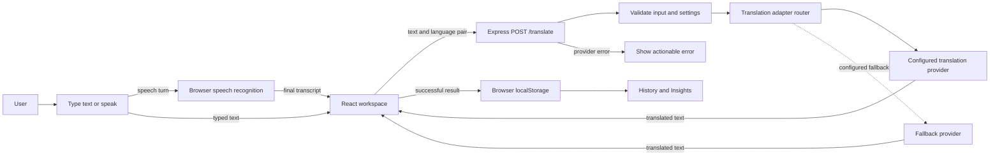
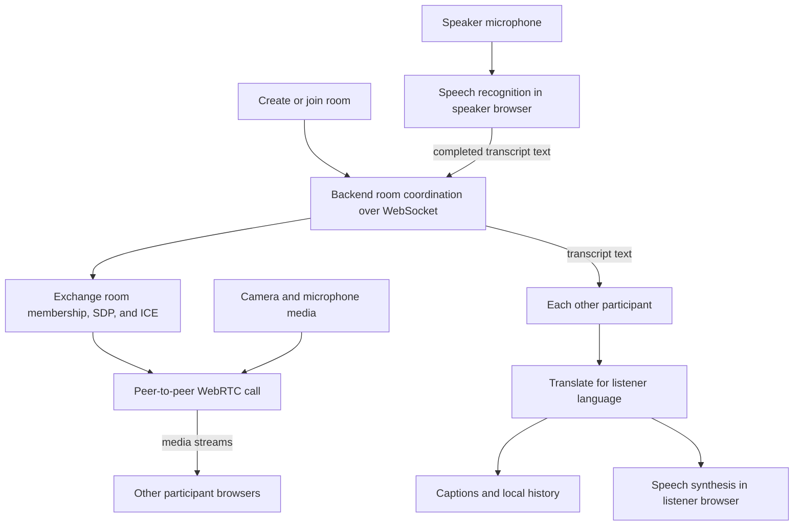
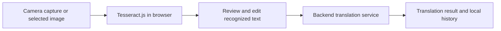
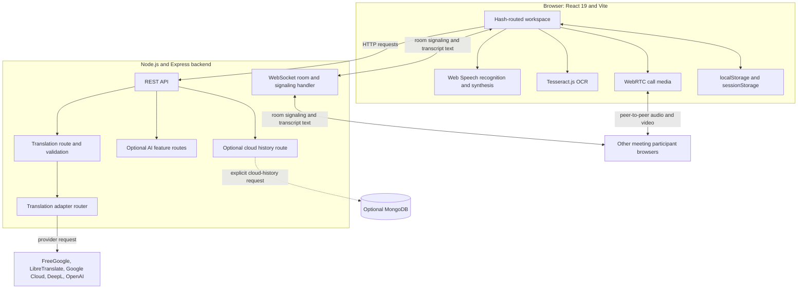

# AWAZ 2.0

**A multilingual communication workspace for conversations, translation, and speaking practice.**

AWAZ lets people translate text and speech, interpret turn based conversations, translate text found in images, and hold voice or video meetings with translated captions and speech. It is a browser app with a React frontend and an Express backend. There is no sign in or account system.

> Breaking language barriers. Connecting people through intelligence.

## Contents

- [What AWAZ can do](#what-awaz-can-do)
- [How the project works](#how-the-project-works)
- [Architecture](#architecture)
- [Data and privacy](#data-and-privacy)
- [Run AWAZ locally](#run-awaz-locally)
- [Configuration](#configuration)
- [API overview](#api-overview)
- [Build, checks, and deployment](#build-checks-and-deployment)
- [Project structure](#project-structure)
- [Known limits](#known-limits)
- [More documentation](#more-documentation)

## What AWAZ can do

| Workspace | What it does |
| --- | --- |
| **Translate** | Translate typed text or a completed speech turn. Choose source and target languages, swap them, play the result aloud, and optionally review a translation or inspect mixed-language text. Successful translations are saved automatically in local browser history. |
| **Live** | Let two people take turns speaking in different languages. AWAZ recognizes each turn in the browser, translates it, and can read the translation aloud. |
| **Vision** | Capture or upload an image, recognize text in the browser with Tesseract.js, edit the result, and translate it. The image itself is not uploaded to the AWAZ backend. |
| **Speak** | Hear a sample phrase, record yourself, and compare the browser's transcript with the phrase. This checks text matching; it is not a pronunciation score. |
| **Meetings** | Start or join a voice or video room for two people, or a conference room for up to six. Each listener chooses the language they want to hear. Meetings include captions, translated speech, mic and camera controls, connection quality, and an optional recap you can save on your device. |
| **History** | Browse, copy, export, or delete translations saved in this browser. |
| **Insights** | View saved translations by day, local time, language, and recent activity, along with speaking practice attempts. |
| **Settings** | Choose the translation provider and default context, manage a personal glossary, and adjust voice speed, text size, contrast, and motion. |

The app offers 25 language choices. Actual language coverage and quality depend on the selected translation provider.

## How the project works

### Text and speech translation

1. The user types text or starts speech recognition from the Translate workspace.
2. For speech, the browser's speech recognition API collects a turn. AWAZ waits for the final transcript when the user stops listening.
3. The frontend sends the text and language pair to the backend using `POST /translate`.
4. The backend validates the request, selects the configured provider adapter, and tries configured fallbacks if needed.
5. The translated text returns to the browser. On success, AWAZ saves the translation locally and displays it in History and Insights.
6. If translation fails, AWAZ shows an error instead of inventing a result.



Translation review and mixed-language analysis are optional features on the Translate page. They use optional backend AI routes when configured; they do not replace the standard translation request.

### Meeting calls and interpreted speech

1. A person creates a room or joins with a room code and chooses voice, video, or conference mode.
2. The backend keeps room membership and relays WebRTC setup messages over `/ws`.
3. Browsers establish peer-to-peer WebRTC connections for call audio and video.
4. Each speaker's browser recognizes a completed speech turn and sends its transcript text through the meeting WebSocket.
5. The backend relays that text to the other room members. Each listener translates it into their selected language, displays captions, and can hear browser-synthesized speech.
6. Successful translated turns are saved in each listener's local translation history. Meeting recap notes are saved only when the user reviews and saves them.



The meeting server carries signaling and transcript text, not audio or video frames. Rooms are temporary and kept in backend memory while participants are connected. Meeting codes are invite codes, not account authentication.

### Image translation



## Architecture

AWAZ uses a browser frontend for the workspace and device features, and a backend for translation providers, API validation, and meeting coordination.



### Main technology

- **Frontend:** React 19, Vite 8, React Router hash navigation, and Lucide icons.
- **Backend:** Node.js 20.19+, Express 4, WebSocket, Helmet, CORS, and rate limiting.
- **Translation:** provider adapters for FreeGoogle, LibreTranslate, Google Cloud Translation, DeepL, and OpenAI, with configurable fallback order.
- **Speech:** browser Web Speech APIs for recognition and speech synthesis.
- **Image text:** Tesseract.js running in the browser.
- **Calls:** WebRTC for peer media; backend WebSocket for room membership, signaling, and completed transcript relay.
- **Storage:** browser storage for everyday preferences, translations, glossary entries, practice attempts, and saved meeting recaps. MongoDB is optional and only used for explicit cloud-history API requests.

### Backend request flow

- `GET /health` reports backend and database status.
- `GET /languages` returns the language catalog.
- `POST /translate` validates and translates text through the selected provider.
- `GET /meeting/ice` returns STUN and configured short-lived TURN connection settings.
- `/ws` coordinates meeting rooms and relays signaling and transcript text.
- `/ai/*` contains optional AI routes for translation review, mixed-language analysis, and audio workflows.
- `/history` supports the optional legacy cloud-history API. The normal workspace history is local to the browser.

## Data and privacy

| Data | Where AWAZ keeps or processes it |
| --- | --- |
| Translation history | Automatically saved in this browser's localStorage, up to 500 entries. Clear it from History at any time. |
| Preferences and glossary | Saved in this browser's localStorage. |
| Speaking practice attempts | Saved locally and used by Insights. |
| Meeting recap notes | Saved locally only after review and confirmation. |
| Temporary context | If enabled, stored in sessionStorage and expires after one hour. |
| Image text recognition | Runs in the browser. Tesseract.js may download language data when first needed; image bytes are not sent to the AWAZ backend. |
| Speech recognition | Runs through the browser's speech service. Browser vendors may process microphone audio under their own policies. |
| Meeting audio and video | Sent between participants using peer-to-peer WebRTC. STUN and optional TURN servers help establish the connection. |
| Meeting transcripts | Recognized by the browser and relayed as text through the backend while the room is active. AWAZ does not persist meeting transcripts. |
| Provider requests | Text sent for translation is sent from the backend to the selected translation provider. Provider credentials stay on the backend. |
| Optional cloud history | The backend can save records to MongoDB only when a request explicitly opts in. A browser ID is a data partition key, not authentication. |

The app has no user accounts. Do not treat room codes or browser IDs as identity verification.

## Run AWAZ locally

Install **Node.js 20.19 or later** and npm. Install the frontend and backend dependencies separately.

### 1. Configure and start the backend

In PowerShell:

```powershell
cd awaz-backend
Copy-Item .env.example .env
npm ci
npm run dev
```

Edit `awaz-backend/.env` to select a translation provider and add any required credentials. The backend listens on `http://localhost:3000` by default. MongoDB is optional for normal local translation and local history.

### 2. Start the frontend

Open a second PowerShell terminal:

```powershell
cd Awaz-frontend
npm ci
npm run dev
```

Open the Vite URL shown in the terminal, normally **http://localhost:5173**. The development server proxies the main API and meeting WebSocket requests to the backend.

For optional `/ai/*` routes in Vite development, set `VITE_API_BASE_URL=http://localhost:3000` in `Awaz-frontend/.env.local`, then restart Vite. The backend CORS setting must allow `http://localhost:5173`.

To stop either server, press `Ctrl+C` in its terminal.

## Configuration

The main backend settings are in `awaz-backend/.env.example`.

| Variable | Purpose |
| --- | --- |
| `PORT` | Backend port. Defaults to `3000`. |
| `ALLOWED_ORIGINS` | Comma-separated frontend origins allowed by CORS. Set exact production origins when deploying. |
| `TRANSLATE_ENGINE` | Default provider: `freegoogle`, `libretranslate`, `google`, `deepl`, or `openai`. |
| `TRANSLATE_FALLBACKS` | Ordered provider fallback list. |
| `LIBRETRANSLATE_URL`, `LIBRETRANSLATE_APIKEY` | LibreTranslate endpoint and optional/required key, depending on the service. |
| `GOOGLE_TRANSLATE_API_KEY` | Google Cloud Translation credential. |
| `DEEPL_API_KEY`, `DEEPL_API_URL` | DeepL credential and API endpoint. |
| `OPENAI_API_KEY`, `OPENAI_MODEL` | Optional OpenAI-backed translation and AI features. |
| `OPENAI_ANALYSIS_MODEL` | Model for optional translation analysis; defaults to the configured OpenAI model. |
| `OPENAI_TRANSCRIBE_MODEL`, `OPENAI_SPEECH_MODEL` | Models for optional audio transcription and speech generation routes. |
| `MONGO_URI` | Optional MongoDB connection for cloud-history API requests. |
| `TURN_SERVER_URLS`, `TURN_SHARED_SECRET` | Optional coturn REST configuration for meetings across restrictive networks. Keep the shared secret on the backend. |
| `RATE_LIMIT_MAX`, `REQUEST_TIMEOUT_MS`, `LOG_LEVEL` | General API rate limit, provider timeout, and log verbosity. |

Never put provider secrets in frontend code or variables prefixed with `VITE_`. The default FreeGoogle adapter uses an undocumented public endpoint and has no availability guarantee. Configure a provider you control for a deployed app. Some providers require credentials even when a fallback is configured.

## API overview

| Method and path | Purpose |
| --- | --- |
| `GET /health` | Backend status, configured engine, and database availability. |
| `GET /languages` | Supported UI language catalog. |
| `POST /translate` | Translate text for a source and target language. |
| `GET /meeting/ice` | Return WebRTC ICE server settings. |
| `WS /ws` | Meeting room membership, WebRTC signaling, and transcript relay. |
| `/ai/*` | Optional review, code-switch, transcription, speech, and consent routes. |
| `GET/DELETE /history` | Optional MongoDB-backed cloud history API. |

For request schemas, validation limits, and error responses, see [API_DOCUMENTATION.md](API_DOCUMENTATION.md).

## Build, checks, and deployment

### Frontend

```powershell
cd Awaz-frontend
npm run build
npm run lint
npm test
```

### Backend

```powershell
cd awaz-backend
npm run check
```

The frontend build is written to `Awaz-frontend/dist`. The backend's `npm start` serves that build when it exists:

```powershell
cd Awaz-frontend
npm run build
cd ..\awaz-backend
npm start
```

For separate frontend and backend hosting, build the frontend with `VITE_API_BASE_URL` set to the deployed backend origin, then configure that exact frontend origin in backend `ALLOWED_ORIGINS`. Deployed meetings require HTTPS and WebSocket support; a TURN relay may be needed on restrictive networks. The repository also includes a GitHub Pages workflow for the frontend, which still needs a separately deployed backend URL.

## Project structure

```text
Awaz-app-main/
├── Awaz-frontend/
│   ├── src/
│   │   ├── components/       Shared layout, navigation, and translation panels
│   │   ├── data/             Language catalog and UI data
│   │   ├── hooks/            Speech and settings hooks
│   │   ├── lib/              API client, glossary, and browser storage
│   │   └── pages/            Translate, Live, Vision, Speak, Meetings,
│   │                         History, Insights, and Settings
│   ├── tests/                Frontend unit tests
│   └── vite.config.js        Dev server and backend proxy
├── awaz-backend/
│   ├── server/
│   │   ├── config/           Environment and database configuration
│   │   ├── middleware/       Security, request logging, and error handling
│   │   ├── models/           Optional MongoDB translation model
│   │   ├── routes/           REST API routes
│   │   ├── services/         Provider adapters and WebSocket meeting logic
│   │   └── server.js         Express and WebSocket entry point
│   └── tests/                Backend tests
├── .github/workflows/        GitHub Pages deployment workflow
├── ARCHITECTURE.md
├── API_DOCUMENTATION.md
├── DEPLOYMENT.md
└── README.md
```

## Known limits

- Speech recognition availability and quality depend on the browser and often require internet access.
- Translation provider language support, pricing, and availability vary. Translation is not guaranteed to be correct.
- Live conversations and meetings are turn based. AWAZ does not provide simultaneous human-like interpretation.
- Meeting rooms do not authenticate users; anyone with the room code may be able to join while the room is active.
- WebRTC may need a configured TURN server for some networks.
- Speaking practice compares text transcriptions; it does not evaluate pronunciation.
- OCR readability confidence is not translation confidence.
- AWAZ does not include offline machine translation or downloadable speech packs.

## More documentation

- [Architecture and data flow](ARCHITECTURE.md)
- [API reference](API_DOCUMENTATION.md)
- [Development guide](DEVELOPMENT_GUIDE.md)
- [Deployment guide](DEPLOYMENT.md)
- [AI engine and optional AI features](AI_ENGINE.md)
- [Privacy notes](PRIVACY.md)
- [Feature integration plan](AI_FEATURE_INTEGRATION_PLAN.md)
- [Roadmap](ROADMAP.md)
