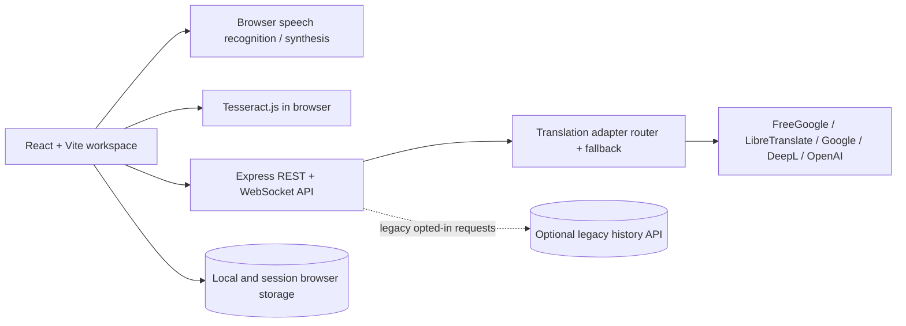

# AWAZ 2.0

AWAZ is a multilingual communication workspace for text translation, browser speech, image text extraction, interpreted calls and turn based interpreting. It has no login, signup, profile or account system.

> **Product line:** Breaking language barriers. Connecting people through intelligence.

## What is in this build

- **Translate:** text translation, language swap, 25 language choices, browser speech recognition and speech playback. Speech is buffered until you stop listening, then translated as one turn. Translation runs through a backend provider; failures are shown as errors and are never replaced with invented text.
- **Live conversation:** two configurable speakers take turns. Each complete turn is recognized in the browser, translated by the backend and optionally played aloud.
- **Vision:** upload an image or capture one with the camera, run OCR in the browser, edit the extracted text and translate it. OCR confidence comes from Tesseract; it is not translation confidence.
- **Speak:** practice a phrase using device speech synthesis and compare the browser's transcript with the reference text; it does not score pronunciation.
- **Translation review:** optionally checks quantities, dates, currency, units, omissions and meaning, with a back-translation comparison. Results are review hints and are never marked verified.
- **Mixed-language translation:** optionally labels code-switched words and phrases with script, language, transliteration and meaning, then applies a natural translation. If AI analysis is unavailable, the regular translator and approximate script grouping remain available.
- **Meetings:** create voice or video rooms for two people, or a conference room for up to six. Each speaker selects a language and finishes a speech turn before it is translated; optional pause detection can finish turns hands free. Calls include mic/camera controls and a live network quality estimate. Review and save recap notes locally when you choose.
- **Voice frequency meter:** while the microphone is active, view its local audio spectrum, strongest measured frequency and level. Audio is not recorded or included in Insights.
- **History and insights:** successful translations save in this browser automatically. Insights chart saved translation frequency by day and local hour, alongside actual practice attempts. History is not disabled in Settings.
- **Settings:** choose providers, manage a browser-only translation glossary, and tune voice speed, text size, contrast and motion.
- **Service foundation:** modular translation adapters, provider fallback, input limits, request throttling, health reporting, CORS, security headers, WebSocket meeting signaling and local translation history.

Meeting transcripts pass through the AWAZ backend for room delivery and translation; call audio/video use peer-to-peer WebRTC. Browser speech recognition may use the browser provider, and translated voice is synthesized on each listener's device.

AWAZ does not currently ship offline machine translation or downloadable speech packs. OCR uses browser side Tesseract.js and may download recognition data on first use.

## Architecture assessment

The project uses React 19/Vite, an Express API, Web Speech and Tesseract hooks, multiple translation adapters, WebSocket meeting signaling, WebRTC calls and a Mongoose translation model. Translation failures are shown to the user, history stays in browser storage, and MongoDB outages do not prevent backend startup.

The upgraded app keeps the existing stack and adapters. Translation requests go through Express; credentials remain server side. Translation and practice history are saved in browser storage. Meeting rooms use eight-character invite codes and are not account authenticated. No accounts are created.



See [AI_FEATURE_INTEGRATION_PLAN.md](AI_FEATURE_INTEGRATION_PLAN.md), [ARCHITECTURE.md](ARCHITECTURE.md), [AI_ENGINE.md](AI_ENGINE.md), [API_DOCUMENTATION.md](API_DOCUMENTATION.md), [PRIVACY.md](PRIVACY.md), [DEPLOYMENT.md](DEPLOYMENT.md), [DEVELOPMENT_GUIDE.md](DEVELOPMENT_GUIDE.md) and [ROADMAP.md](ROADMAP.md) for the implementation details and limits.

## Requirements

- Node.js **20.19+** (the Vite 8 frontend and Mongoose 9 backend require a modern Node runtime)
- npm
- MongoDB is optional; browser history needs no database

## Run locally

In one terminal, configure and start the backend:

```powershell
cd awaz-backend
Copy-Item .env.example .env
npm ci
npm run dev
```

In a second terminal, start the frontend:

```powershell
cd Awaz-frontend
npm ci
npm run dev
```

Open the Vite URL, normally `http://localhost:5173`. The development server proxies API and meeting WebSocket requests to `http://localhost:3000`. Browser history works without MongoDB. Meetings need microphone permission; deployed sites must use HTTPS and support WebSockets.

The sample CORS origins in `awaz-backend/.env.example` allow local Vite and the local backend. For another frontend origin, set `ALLOWED_ORIGINS` to a comma separated list of exact origins.

## Environment variables

Copy `awaz-backend/.env.example` to `.env`. The main settings are:

| Variable | Purpose |
| --- | --- |
| `PORT` | Backend port; defaults to `3000`. |
| `MONGO_URI` | Optional MongoDB connection for legacy cloud-history API requests. Local history does not use it. |
| `ALLOWED_ORIGINS` | Exact allowed frontend origins, comma separated. |
| `TRANSLATE_ENGINE` | Default adapter: `freegoogle`, `libretranslate`, `google`, `deepl` or `openai`. |
| `TRANSLATE_FALLBACKS` | Comma separated fallback adapters; sample uses `freegoogle,libretranslate`. |
| `LIBRETRANSLATE_URL`, `LIBRETRANSLATE_APIKEY` | LibreTranslate endpoint and API key; the default public endpoint requires a key. |
| `GOOGLE_TRANSLATE_API_KEY`, `DEEPL_API_KEY`, `DEEPL_API_URL` | Optional provider credentials. |
| `OPENAI_API_KEY`, `OPENAI_MODEL` | Required when using OpenAI for contextual translation. |
| `OPENAI_ANALYSIS_MODEL` | Optional model for translation review and mixed-language analysis; defaults to `OPENAI_MODEL` or `gpt-4o-mini`. |
| `OPENAI_TRANSCRIBE_MODEL` | Optional audio transcription model; defaults to `gpt-4o-transcribe-diarize`. |
| `OPENAI_SPEECH_MODEL` | Optional generated speech model; defaults to `gpt-4o-mini-tts`. |
| `AI_REQUEST_TIMEOUT_MS`, `AI_AUDIO_MAX_BYTES` | AI provider timeout and maximum transcription upload; defaults are 45 seconds and 20 MiB. Voice consent/sample uploads are capped at 10 MiB. |
| `RATE_LIMIT_MAX`, `REQUEST_TIMEOUT_MS`, `LOG_LEVEL` | Request limits, provider timeout and log verbosity. |

Do not put provider keys in `Awaz-frontend` or a `VITE_` variable. The default `freegoogle` adapter uses an undocumented public endpoint and has no availability guarantee. For a deployed service, configure a provider you control and set a fallback appropriate to its supported languages.

The frontend uses the same origin by default in production. For a separately hosted backend, set the build variable `VITE_API_BASE_URL` to the backend origin and add the deployed frontend origin to `ALLOWED_ORIGINS`.

## Checks

```powershell
# Frontend
cd Awaz-frontend
npm run build
npm run lint
npm test

# Backend
cd ..\awaz-backend
npm run check
```

The tests cover language catalog integrity, core translation API behavior and the optional AI review, mixed-language, transcription, speech and voice-consent routes. Browser microphone, camera, OCR, accessibility and live paid-provider behavior still need manual checks on the target browsers and deployment.

## Deployment

For a single service, build the frontend with `npm run build` in `Awaz-frontend`, then run `npm start` in `awaz-backend`; Express serves `Awaz-frontend/dist`. For separate hosting, serve the frontend as static assets and configure `VITE_API_BASE_URL` at build time. Configure the backend environment, provider credentials and exact CORS origins. Remote meetings need HTTPS and WebSocket support. For restrictive networks, configure coturn REST shared-secret mode and set backend-only `TURN_SERVER_URLS` and `TURN_SHARED_SECRET`; the backend issues short-lived credentials from `GET /meeting/ice`. GitHub Pages builds only the frontend; it needs the repository variable `VITE_API_BASE_URL` to point at a deployed backend.

See [DEPLOYMENT.md](DEPLOYMENT.md). No free-tier provider or hosting plan is guaranteed to remain free.
# Awaz-App

